# 🫁 ApneaSense

**AI-powered web app that detects Obstructive Sleep Apnea (OSA) and grades its severity from ECG and SpO₂ sleep recordings.**

Final Year Project, BS Data Science / BS Artificial Intelligence, Pak-Austria Fachhochschule: Institute of Applied Sciences and Technology (Spring 2026)

---

## 📸 Demo

Upload a sleep recording, watch the analysis run, and get results in a dashboard and PDF report. Here is a quick tour of the app, in the order a user would experience it.

### 1️⃣ Landing page
<p align="center">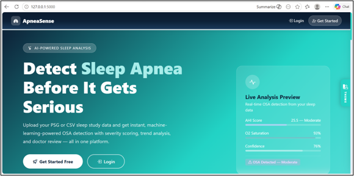</p>

### 2️⃣ Patient: upload data and get results

| Dashboard | Upload sleep data |
|:---:|:---:|
| 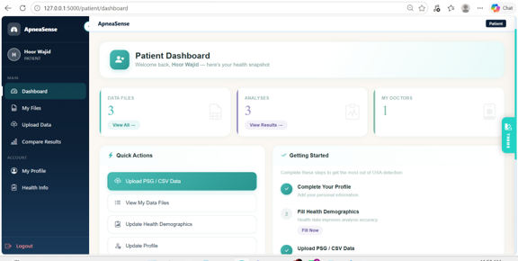 | 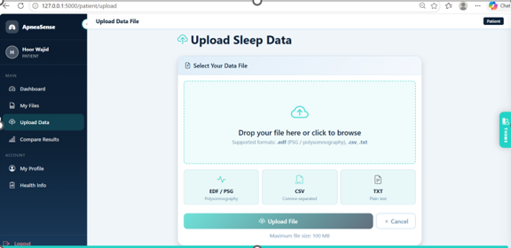 |
| **Health profile** | **SpO₂ / oxygen report** |
| 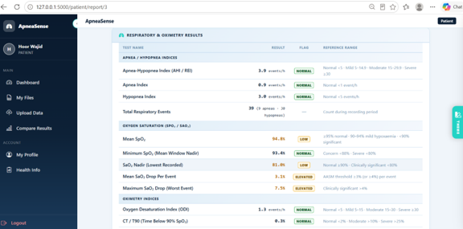 | 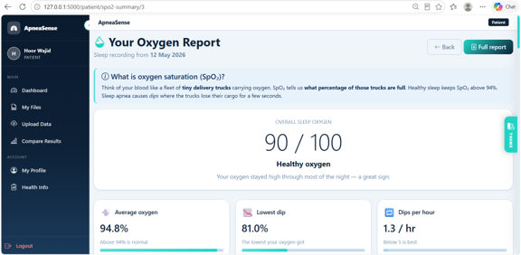 |

### 3️⃣ Doctor: review and compare patients

| Dashboard | My patients |
|:---:|:---:|
| 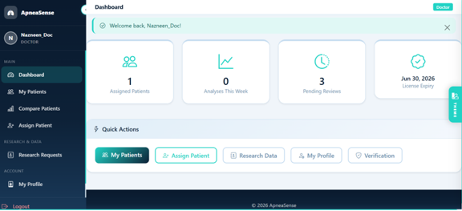 | 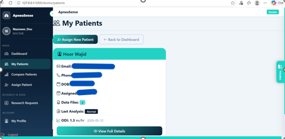 |
| **Compare patients** | **SpO₂ & desaturation report** |
| 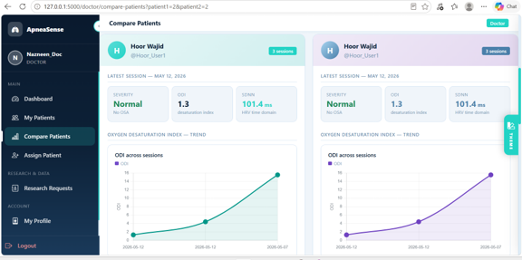 | 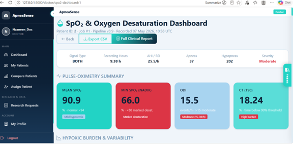 |

### 4️⃣ Admin: monitor, verify and audit

| System monitoring & analytics | Doctor verification |
|:---:|:---:|
| 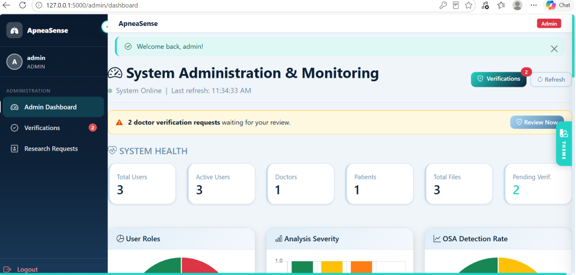 | 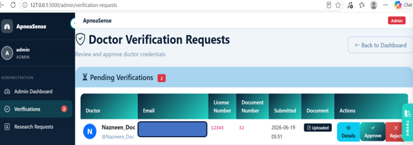 |

**Audit log**
<p align="center">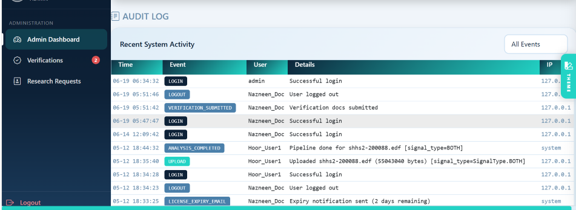</p>

---

## 💡 What & Why

Up to **936 million people** worldwide have OSA, but most are undiagnosed because the gold-standard test (polysomnography) is expensive, lab-bound and labour-intensive.

ApneaSense offers a low-cost screening alternative. A user uploads an overnight ECG / SpO₂ file. The app extracts heart-rate-variability and oxygen-desaturation features, scores AHI/REI using AASM rules, and predicts **whether OSA is present** and **how severe it is** (Normal, Mild, Moderate, Severe). Doctors can review results, and admins manage verification and audit.

**Results (SHHS Cohort 1, 2,054 patients, 10-fold CV):**

| Task | Model | Key metrics |
|---|---|---|
| OSA detection | Random Forest | ROC-AUC **0.998**, balanced accuracy **98.7%**, sensitivity **95.8%** |
| Severity (4 classes) | LightGBM | Macro-F1 **0.91**, weighted κ **0.907** |

ML inference takes under 1 second. A full 8-hour recording is processed in about 8–15 minutes.

---

## ✨ Features

- 📤 Upload **EDF / CSV / TXT** recordings with automatic signal-type detection
- ❤️ **HRV features** from ECG (SDNN, RMSSD, pNN50, LF/HF, entropy, etc.)
- 🩸 **Oximetry biomarkers** from SpO₂ (ODI, CT90, hypoxic burden)
- 🌬️ **AHI/REI scoring** following AASM rules
- 🤖 **Two ML models:** OSA presence and 4-class severity, with confidence labels
- 📊 Role-based dashboards for **Patient, Doctor and Admin**
- 🧾 One-click **PDF clinical report**
- 👨‍⚕️ Doctor review notes, patient comparison, and admin-verified doctor credentials
- 🔐 Audit logs, CSRF protection, rate limiting and account lockout

---

## 👥 Team

| Member | Roll No. | Program | Role |
|---|---|---|---|
| **Hoor-ul-ain Wajid** | B22F0068DS004 | BS Data Science | Backend development & signal processing (HRV / SpO₂ feature extraction) |
| **Maheen Shahid** | B22F0944DS025 | BS Data Science | Machine learning: model training, SMOTE & evaluation (Random Forest, LightGBM) |
| **Muhammad Asjad** | B21F0179AI024 | BS Artificial Intelligence | Frontend dashboards, testing & deployment |

**Academic Supervisor:** Dr. Shahnawaz Qureshi
**Industry Supervisor:** Dr. Wajid Aziz, Abbas Institute of Medical Sciences, Muzaffarabad

---

## 🧰 Tech Stack

Python 3.11 · Flask · SQLAlchemy · NeuroKit2 · pobm · SciPy · scikit-learn · LightGBM · XGBoost · SHAP · Bootstrap 5 · Chart.js · SQLite (PostgreSQL-ready)

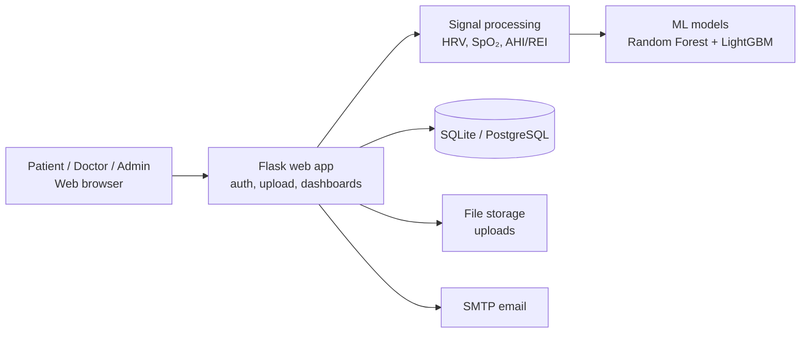

---

## 🚀 Installation

**Prerequisites:** Python 3.11+, Git, and an SMTP account for email confirmation.

```bash
# 1. Clone the repository
git clone https://github.com/HoorWajid/osa-webapp.git
cd osa-webapp

# 2. Create and activate a virtual environment
python -m venv venv
venv\Scripts\activate        # Windows
# source venv/bin/activate   # macOS / Linux

# 3. Install dependencies
pip install -r requirements.txt
```

Create a `.env` file in the project root:

```env
SECRET_KEY=change-me
DATABASE_URL=sqlite:///instance/app.db
MAIL_SERVER=smtp.example.com
MAIL_PORT=587
MAIL_USERNAME=you@example.com
MAIL_PASSWORD=your-app-password
```

Place the trained model files in `app/ml_models/`, then start the app:

```bash
python run.py
```

Open **http://127.0.0.1:5000**

---

## 🧭 Usage

1. **Register** as a Patient and confirm your email (doctors need admin approval).
2. Fill in **Health Info** (age, BMI, blood pressure, etc.).
3. **Upload** an EDF or CSV sleep recording (max 100 MB) and click **Analyze**.
4. Watch the live progress bar, then open the **dashboard** to see OSA prediction, severity, AHI/REI, HRV and SpO₂ charts.
5. Download the **PDF report**. Doctors can add clinical notes and compare sessions.

Run the tests with:

```bash
pytest
```

---

## 🤝 Contributing

Contributions, bug reports and feature requests are welcome.

1. Fork the repo and create a branch: `git checkout -b feature/your-feature`
2. Commit your changes: `git commit -m "Add your feature"`
3. Push and open a **Pull Request** against `dev`
4. For bugs, open an **Issue** with steps to reproduce

---

## ⚠️ Limitations & Disclaimer

Trained on SHHS Cohort 1 only and not clinically validated; it works on uploaded files, not live wearables. Planned work: SHAP charts in the dashboard, per-event apnea timeline, confidence intervals, wearable integration and cloud deployment.

**ApneaSense is an academic prototype, not a certified medical device. It must not replace professional diagnosis.**

---

## 📄 License

Distributed under the **MIT License**. See `LICENSE` for details.

---

## 🙏 Acknowledgements

Dataset: Sleep Heart Health Study (SHHS) Cohort 1 via the National Sleep Research Resource (NSRR). Scoring follows the AASM 2012 guidelines.
